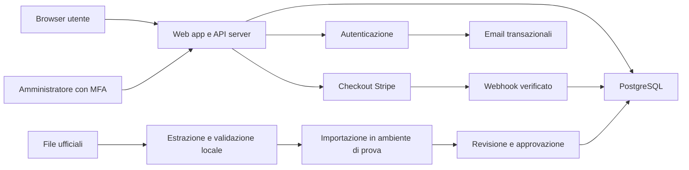

# 03 - Architettura, modello dati e sicurezza

Proposta tecnica per ridurre tempi e manutenzione. Non sono state installate dipendenze né implementate queste strutture.

## 1. Stack consigliato

| Area | Proposta | Ragione |
| --- | --- | --- |
| Applicativo | Next.js con React e TypeScript | Un progetto per pagine e operazioni server, tipi condivisi |
| Interfaccia | Tailwind CSS e componenti accessibili selezionati | Coerenza grafica e rapidità, senza un sistema visivo complesso |
| Dati e identità | Supabase: PostgreSQL, Auth, archivio file privato | Gestione centralizzata e relazioni/transazioni affidabili |
| Pagamento | Stripe Checkout ospitato, pagamento unico | Non gestire campi carta, un solo flusso e una sola riconciliazione |
| Hosting | Vercel Pro in produzione | Pubblicazione e ritorno al rilascio precedente semplici |
| Email | Provider SMTP dedicato, proposta Resend | Verifica email, recupero password e messaggi operativi |
| Estrazione | Procedura locale Python, esportazione JSON normalizzata | PDF/OCR fuori dalle richieste dell'app; adattatore sostituibile |
| Collaudo | Test del dominio e integrazione; test browser con strumento adatto | Concentrarsi su timer, pagamenti, autorizzazioni e percorsi reali |

Versioni dei pacchetti: scegliere release stabili supportate all'avvio, bloccare le dipendenze e registrarle. La scelta non richiede Express, MongoDB, Firebase o un secondo backend. Chi sviluppa può proporre una variante se dimostra minor costo totale con gli stessi criteri di 07.

VPS unico può costare meno in canoni ma aggiunge patch, email, sicurezza, backup e continuità. Non è la prima scelta per una finestra breve. Non introdurre Redis, microservizi o motore di raccomandazioni senza misurazioni che li rendano necessari.

## 2. Confini del sistema

Il browser non decide punteggio, gratuità, scadenza, ruolo o prezzo. L'autenticazione identifica la persona; il server decide se la sessione è autorizzata e se ha diritto a quella operazione. Le soluzioni sono in un'area privata, mai nell'elenco di domande ricevuto prima della consegna.

Le operazioni didattiche protette passano dal server. Non consentire al client accesso diretto che aggiri il controllo della sessione unica. Dove si espone accesso dati del provider, usare privilegi minimi e politiche per riga; non assumere che una politica di proprietà copra anche la revoca di sessione. Le chiavi amministrative restano solo sul server. Riferimento: [Supabase, sicurezza per riga](https://supabase.com/docs/guides/database/postgres/row-level-security), consultato il 14 ottobre 2026.

## 3. Moduli logici

1. Identità e sessioni: registrazione, verifica, recupero, logout, controllo sessione autorizzata.
2. Concorso e regole: fonti, configurazione versionata, stato pubblico e validità.
3. Banca e importazioni: dataset, revisioni, soluzioni private, errori e pubblicazione.
4. Quiz: estrazione, avvio, salvataggio, tempo e finalizzazione.
5. Acquisti e diritti: ordine, checkout, eventi, accesso, revoca e riconciliazione.
6. Progressi: report, storico, aggregazioni e ripasso.
7. Amministrazione e supporto: operazioni controllate e registrazione azioni.
8. Operazioni: lavori periodici, monitoraggio, esportazioni, backup e conservazione.

Separare questi moduli nel codice senza separarli subito in servizi distribuiti. Importatore e formato normalizzato condividono le stesse regole di validazione del database.

## 4. Modello dati logico

| Entità | Campi essenziali | Vincoli e note |
| --- | --- | --- |
| `profiles` | user_id, display_name facoltativo, account_status, created_at | Identità gestita da Auth; niente password nel profilo |
| `user_roles` | user_id, role, granted_by, granted_at | Ruoli assegnati dal server; MFA per amministrazione |
| `authorized_sessions` | user_id, auth_session_id, generation, authorized_at, revoked_at | Un'autorizzazione corrente; ID, non token grezzo |
| `contests` | id, slug, title, official_url, lifecycle_status, active_bank_id, active_rule_id | Stati preparazione/attivo/sospeso/concluso |
| `contest_rule_versions` | id, contest_id, question_count, score_correct_cents, score_wrong_cents, threshold_cents, duration_seconds, timing_status, extraction_policy, source_ref | Versioni immutabili; parametri iniziali 30,100,-33,2100 |
| `source_documents` | id, url o percorso privato, checksum, acquired_at, publication_date, provenance, reuse_status | Tracciare originale e verifica diritti |
| `question_banks` | id, contest_id, version, status, expected_count, actual_count, source_id, approved_by, approved_at | Bozza/validata/approvata/attiva/ritirata; una attiva per concorso |
| `categories` | id, contest_id, name, parent_id facoltativo, classification_source | Categoria ufficiale o editoriale |
| `question_revisions` | id, bank_id, official_id, text, category_id, media_ref, source_page, source_locator, content_hash, status | Unicità banca + ID ufficiale; revisioni immutabili |
| `question_options` | id, revision_id, source_label, text, position, media_ref | Posizioni uniche per quesito; alternative variabili |
| `answer_keys` | revision_id, correct_option_id, source_ref, verification_status | Tabella privata; opzione appartenente allo stesso quesito |
| `question_explanations` | revision_id, text, source_ref, editorial_status, reviewer | Separata dalla chiave; non necessaria per pubblicare |
| `attempts` | id, user_id, contest_id, mode, bank_id, rule_id, status, started_at, deadline_at, finalized_at, duration_setting, score_cents, access_basis | Una prova esame attiva; configurazione congelata |
| `attempt_items` | id, attempt_id, revision_id, position, displayed_option_order | Unicità tentativo + posizione e tentativo + quesito |
| `attempt_answers` | item_id, selected_option_ids, answer_version, saved_at, outcome finale | Una risposta corrente; ID validati; null/vuoto = omessa |
| `trial_ledger` | id, user_id, contest_id, attempt_id, delta, reason, actor, created_at | Consumo -1, accredito +1; unicità del consumo per tentativo |
| `products` | id, contest_id, price_id_provider, amount_cents, currency, terms_version, sales_enabled | Prezzo solo server, versionato |
| `orders` | id, user_id, product_id, amount_cents, currency, provider_checkout_id, payment_id, status, terms_version, valid_until_promised | Riferimenti provider unici; mai numeri di carta |
| `payment_events` | provider, event_id, object_id, type, status, received_at, processed_at, error_code | Event ID unico; dati personali minimizzati |
| `entitlements` | id, user_id, contest_id, order_id, starts_at, ends_at, status, reason | Un accesso effettivo per utente/concorso; revoca esplicita |
| `progress` | user_id, contest_id, question_identity, last_outcome, last_seen_at, review_needed | Aggregato ricostruibile dallo storico; gestire revisioni |
| `support_tickets` | id, user_id, kind, attempt_id/question_revision_id/order_id, description, status, resolution | Limitare dati liberi e allegati; conservazione definita |
| `audit_log` | actor, action, target_type/id, timestamp, reason, minimal_diff | Ruoli, crediti, rimborsi, pubblicazioni e cambi configurazione |
| `policy_acceptances` | user_id/order_id, policy_type, version, accepted_at, evidence_minima | Condizioni, eventuale marketing distinto, scelte legalmente necessarie |
| `jobs` | id, kind, target_id, status, attempts, next_run_at, last_error | Lavori durevoli per email/eventi/scadenze; retry controllato |

I campi descrivono il contratto logico, non SQL già approvato. Prima delle migrazioni precisare tipi, cancellazioni, indici e privilegi. Password e informazioni sulle carte non devono apparire in queste tabelle.

Relazioni principali: concorso → versioni regole e banche → revisioni quesiti → opzioni/chiavi; utente → tentativi → elementi → risposte; utente → ordini → diritti. Ogni dato personale ha un proprietario e uno scopo documentato.

## 5. Vincoli, indici e transazioni

- Indici sulle ricerche per utente/data, tentativi in corso, banca/stato, eventi da elaborare e diritti in scadenza.
- Una transazione per autorizzazione + controllo disponibilità + creazione prova + consumo gratuito. Due richieste contemporanee con un solo credito non possono creare due prove.
- Chiave di idempotenza per avvio: stessa richiesta ritentata restituisce lo stesso tentativo. L'idempotenza è persistente, non una variabile in memoria.
- Salvataggi con versione crescente o controllo di concorrenza: una richiesta vecchia non sovrascrive la risposta nuova. Una seconda scheda riceve un conflitto o lo stato aggiornato.
- Finalizzazione con blocco/transazione: non accetta nuove risposte dopo lo stato finale o il termine; score e conteggi sono salvati insieme.
- Aggiornamento banca attiva atomico; nessuna prova può mescolare due banche. Non cancellare revisioni referenziate da tentativi conservati.
- Ordini, eventi e attivazioni con vincoli unici e stato terminale coerente: un evento ripetuto non raddoppia accessi o rimborsi.
- Il saldo gratuito è derivato dal registro o aggiornato nella stessa transazione, senza due contatori divergenti.

## 6. Stati e finalizzazione del tentativo

`in_progress → submitted` per consegna manuale; `in_progress → expired` a termine. `abandoned` solo se l'utente chiude esplicitamente il tentativo; chiudere il browser non è abbandono. `invalidated` per errore grave confermato, con motivazione e gestione credito. I primi quattro stati non riaprono automaticamente una prova.

Per studio senza timer, definire termine massimo di sessione e chiusura esplicita; evitare sessioni eterne. La durata della sessione di studio non va confrontata con una prova esame.

La scadenza è controllata a ogni lettura/scrittura/consegna; un lavoro periodico finalizza anche i tentativi mai riaperti. Non dipendere da timer del browser o da processi che vivono dentro una singola richiesta serverless. Se il lavoro periodico tarda, il server continua a respingere risposte successive alla deadline.

## 7. Contratti delle operazioni

Percorsi indicativi, da consolidare prima dello sviluppo. Tutte le operazioni autenticano, autorizzano e validano gli input lato server.

| Operazione | Input significativo | Risultato e controllo |
| --- | --- | --- |
| Leggi concorso | slug | Regole pubbliche, versione e stato; niente banca privata |
| Leggi account | identità sessione | Prove residue, diritto, scadenza, tentativo attivo |
| Avvia tentativo | modalità, durata ammessa, idempotency_key | ID, domande senza soluzioni, deadline; accesso controllato |
| Riprendi tentativo | attempt_id | Solo proprietario e sessione corrente; risposte salvate |
| Salva risposta | item_id, option_id oppure omissione, answer_version | Nuova versione e orario server; opzione deve appartenere all'item |
| Consegna | attempt_id, richiesta identificata | Finalizzazione unica; report solo dopo successo |
| Feedback studio | item_id e risposta | Correzione della domanda confermata, mai quelle future |
| Storico/statistiche | periodo, modalità, paginazione | Solo dati dell'utente; dataset e regole identificati |
| Crea checkout | product_id | URL provider; prezzo e utente determinati dal server |
| Stato acquisto | order_id | Pagamento/accesso, nessun attivatore controllato dal browser |
| Webhook | payload grezzo, firma provider | Verifica origine, registrazione durevole, elaborazione idempotente |
| Segnalazione | riferimento e testo | Ticket con ID; limite frequenza |
| Esporta/cancella | identità verificata e conferma | Richiesta tracciata; verifica identità e gestione conservazione |
| Importa/pubblica banca | pacchetto validato, manifest, versione | Solo amministratore; report, approvazione e audit |

Errori leggibili: sessione sostituita, login necessario, prova esaurita, accesso scaduto, banca non disponibile, prova terminata, conflitto di salvataggio, frequenza eccessiva, errore temporaneo. Non rivelare dettagli interni o esistenza di un altro account nei recuperi password. Usare un ID di riferimento per supporto.

## 8. Sessione unica: requisito e limite

La verifica di firma/scadenza JWT non revoca automaticamente un accesso già emesso. Proposta: registrare sul server l'ID della sessione Auth autorizzata corrente e controllarlo a ogni operazione protetta. Alla nuova autenticazione sostituire atomicamente il riferimento; il vecchio token può essere formalmente valido ma l'app lo respinge.

Distinguere login effettivo dal refresh del token: un refresh non deve espellere la stessa sessione né creare un nuovo dispositivo. Più schede nella stessa sessione sono consentite ma coordinate; una sola prova esame attiva. Reset password, sospensione e operazioni di sicurezza revocano i diritti di sessione secondo policy.

La [documentazione Supabase sulle sessioni](https://supabase.com/docs/guides/auth/sessions), consultata il 14 ottobre 2026, indica la funzione di sessione unica nei piani Pro e superiori e precisa che il controllo nativo agisce al refresh, con effetto legato alla scadenza JWT. Non usarla come prova di espulsione immediata. Testare il controllo applicativo anche su API, storage, esportazioni e report; le richieste già concluse non possono essere annullate retroattivamente.

Sessione unica è una misura anti-condivisione, non una garanzia. Niente blocco basato solo su IP: reti mobili cambiano indirizzo e famiglie possono condividere la rete. Niente fingerprint invasivo nella prima versione.

## 9. Sicurezza e ambienti

- Ambienti locale, prova e produzione con database e chiavi separati; dati sintetici in prova. Mai usare dati reali degli utenti per demo.
- HTTPS, sessioni sicure, protezione CSRF dove pertinente, controlli origine, policy dei contenuti e validazione output.
- Sanificare testi importati: domanda o spiegazione non può inserire script/HTML attivo. Limiti su file, dimensioni, MIME e archivio privato; collegamenti temporanei solo se autorizzati.
- Verifica firma del webhook sul corpo originale; segreti fuori codice e browser; rotazione e recupero documentati.
- Limiti distribuiti di frequenza per login, registrazione, reset, avvii, checkout, salvataggi e ticket. Non basarsi su memoria locale dell'istanza; soglie compatibili con l'uso didattico.
- Nessuna cache condivisa per account, tentativi o report; non inserire soluzioni in file statici o PWA. Solo asset pubblici in cache.
- MFA per amministratore e account fornitori; backup dei codici di recupero, accesso minimo e account intestati al titolare.
- Dipendenze aggiornate con controllo, nessuna chiave nei log; audit per operazioni amministrative e autorizzazioni testate con utenti distinti.
- Importazione offline non carica automaticamente il PDF su un servizio IA esterno. Se servisse, verificare dati, diritti, costi e condizioni prima dell'uso.

## 10. Prestazioni e manutenzione

1. Recuperare i 30 quesiti con poche letture; non aprire una connessione per domanda.
2. Usare pool di connessioni adatto all'hosting e indici verificati.
3. Aggiornare statistiche dopo finalizzazione, senza ricalcolare l'intero storico a ogni schermata.
4. Ridurre polling: salvataggi su modifica, timer locale sincronizzato col server, controllo stato solo quando necessario.
5. Separare lavori pesanti di importazione da richieste utente e tempi di hosting.
6. Migrazioni versionate, prova di migrazione e ripristino; rollback app distinto dal rollback dati.
7. Monitorare tempi, errori, connessioni, traffico, email ed eventi pagamenti; l'aumento dei piani avviene per bisogno misurato.

Gli obiettivi di carico e qualità sono in 07; l'importatore e il pacchetto dati sono in 04. Il sistema va progettato per questo concorso senza costruire subito una piattaforma multi-concorso generalista.
