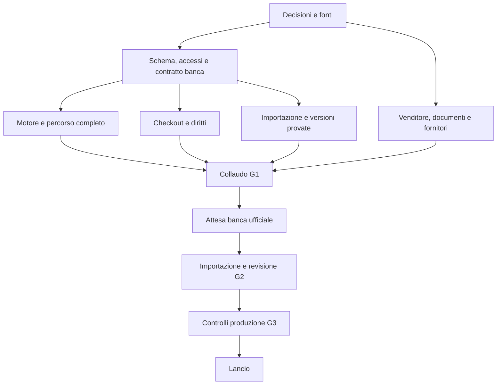

# 06 - Roadmap, attività e ordine di esecuzione

Questo è il piano da trasformare in una bacheca operativa prima dello sviluppo. Tutte le attività tecniche sono ancora da fare. Documentazione prodotta ora non equivale a implementazione, revisione legale o collaudo già eseguito.

## 1. Responsabilità

**PO:** Davide/titolare, decide offerta, budget, perimetro e apertura. **DEV:** sviluppatore responsabile, anche con assistenza di agenti, realizza e verifica. **UX:** progettazione dell'esperienza, accorpabile a DEV. **CONT:** revisore dei contenuti. **QA:** verifica del prodotto. **OPS:** gestione ambienti e servizio. **CONS:** consulente legale/fiscale per gli aspetti di competenza.

Una persona può coprire più ruoli, ma i tempi non si accorciano automaticamente. Assegnare nomi reali, disponibilità e sostituto per l'intervento al lancio. Agenti possono aiutare nella realizzazione e nell'estrazione, ma non assumono titolarità del servizio o certificano autonomamente adempimenti e diritti.

## 2. Fasi e risultati

| Fase | Scopo | Risultato necessario per passare oltre |
| --- | --- | --- |
| F0 - Consolidamento | Decidere perimetro, scadenza e responsabilità | Decisioni essenziali chiuse, verifiche esterne avviate, task assegnati |
| F1 - Fondazioni e contratto dati | Preparare schema, ambienti, identità e dataset | Accessi e importazione base funzionanti con dati sintetici |
| F2 - Esperienza didattica | Realizzare esame, studio, ripasso e report | Percorso completo, punteggio/timer/salvataggio verificati |
| F3 - Monetizzazione e amministrazione | Acquisto, diritto, sessione unica, supporto | Flussi di pagamento e gestione provati, controlli server attivi |
| F4 - Prontezza prima della banca | Collaudo, operazioni, importazione completa | G1: app e servizio pronti con dati di prova; vendite reali chiuse |
| F5 - Integrazione ufficiale | Acquisire e validare i quesiti | G2: banca verificata, fonti e chiavi complete |
| F6 - Apertura e presidio | Controlli produzione e primi utenti | G3: apertura autorizzata dal titolare, assistenza e monitoraggio attivi |
| F7 - Esercizio e conclusione | Rettifiche, rinvii, miglioramenti e chiusura | Servizio mantenuto per la promessa venduta; dati e costi gestiti |

F2 e F3 possono svilupparsi in parte contemporaneamente solo dopo i contratti comuni. Preparazione fiscale/legale, dominio, provider e contenuti procede da F0 senza aspettare F2. L'importatore inizia in F1, non quando arriva la banca.

## 3. Stima iniziale e calendario

Stima di lavoro indicativa per una prima versione essenziale e uno sviluppatore esperto, da sostituire con una stima per task dopo F0:

| Blocco | Giornate-persona indicative |
| --- | --- |
| Decisioni, schemi schermate e contratti | 3 |
| Fondazioni tecniche e ambienti | 2 |
| Motore, interfaccia, report e studio | 5-7 |
| Vendita, accessi e amministrazione minima | 3-4 |
| Pipeline e prove di importazione sintetica | 2-3 |
| Collaudo, sicurezza, operazioni e correzioni | 3-4 |
| Totale prima della banca | 18-23 |

Non comprende tempi di attesa dei fornitori, lavoro dei consulenti, revisione della banca ufficiale, supporto quotidiano o evoluzioni. Design raffinato o pannelli amministrativi estesi aumentano lo sforzo. Il lavoro assistito da IA può ridurre alcune attività, ma la stima non presume automaticamente tale riduzione.

Fra 14 e 29 ottobre ci sono 15 giorni di calendario, meno giorni lavorativi: 18-23 giornate-persona non sono una promessa di prontezza entro il 28 ottobre per una persona sola. Il riferimento "pronta prima del 29" è un obiettivo teso. Se necessario, aumentare disponibilità, accorpare ruoli con attenzione o ridurre le funzioni non essenziali; non ridurre verifiche su dati, accessi e pagamenti.

Pianificazione suggerita: chiudere F0 nei primi 2-3 giorni di lavoro; impostare subito identità/schema e importazione, sviluppare il percorso principale in blocchi brevi e verificabili; riservare almeno l'ultimo blocco a G1 e alle correzioni. Ogni due giorni confrontare lavoro residuo, capacità e stato degli avvisi ufficiali. Se la banca arriva prima di G1, continuare l'integrazione in prova senza aprire vendite finché tutti i gate sono passati.

Una versione ridotta può rimandare grafici elaborati, preferiti, spiegazioni, Google, PWA avanzata e supporto multiruolo. Esame, quota gratuita, pagamento, salvataggio, report, importazione, gestione minima e continuità restano necessari alla proposta pagata. Se si rimanda anche studio o ripasso, modificare prima l'offerta e 02, non venderli come presenti.

## 4. Percorso critico

Se manca una chiave corretta o un diritto di riutilizzo, il percorso si ferma in G2. Se manca un provider verificato o un documento di vendita, si ferma in G1/G3. Nessuno dei due problemi è risolvibile con un semplice deploy più veloce.

## 5. Backlog operativo P0

Colonne: ID, responsabile, dipendenze, prova di completamento. Tutte le righe sono P0 salvo indicazione. Le dipendenze indicano predecessori necessari, non impediscono attività preparatorie. Prima di assegnare aggiungere stima, stato, persona e data.

### Consolidamento e preparazione

| ID | Attività | Ruolo | Dipende da | Completata quando |
| --- | --- | --- | --- | --- |
| T01 | Confermare obiettivo, prima versione e decisioni essenziali | PO | - | 08 aggiornato con scelte e motivi |
| T02 | Registro fonti e controllo avvisi del concorso | PO/CONT | - | Fonte, data e parametri verificabili registrati |
| T03 | Verificare riutilizzo commerciale della banca e allegati | PO/CONS | T02 | Esito documentato; integrazione finale da confermare sui file ricevuti |
| T04 | Definire venditore, fiscalità e documentazione richiesta | PO/CONS | T01 | Processo e dati necessari approvati |
| T05 | Definire prezzo, gratuità, validità e rinvio/revoca | PO/CONS | T01,T02 | Politica esplicita utilizzabile da checkout e supporto |
| T06 | Nome, dominio e contatti assistenza | PO | T01 | Scelte verificate e titolarità definita |
| T07 | Schemi delle schermate e prova del percorso mobile | UX/PO | T01,T05 | Percorsi e stati di 02 revisionati |
| T08 | Scegliere stack, regioni, budget e provider | DEV/PO | T01,T04 | Decisioni tecniche e preventivo iniziale registrati |
| T09 | Avviare account/verifiche provider e dominio/email | PO/OPS | T04,T06,T08 | Accessi intestati, MFA e verifiche completate prima del lancio |
| T10 | Assegnare responsabilità e calendario realistico | PO | T01,T08 | Nomi, capacità e ordine lavori concordati |

### Fondazioni e banca sintetica

| ID | Attività | Ruolo | Dipende da | Completata quando |
| --- | --- | --- | --- | --- |
| T11 | Repository, struttura, dipendenze bloccate e controlli automatici | DEV | T08 | Progetto riproducibile e verifica build funzionante |
| T12 | Ambienti locale/prova/produzione e segreti separati | OPS/DEV | T09,T11 | Separazione verificata, nessun dato o chiave reale in prova |
| T13 | Contratto dati banca e schema di validazione | DEV/CONT | T02,T08 | Formato di 04 copre testi, chiavi e media |
| T14 | Dataset sintetico grande e casi limite/invalidi | CONT/DEV | T13 | 1.500 record di prova e anomalie note disponibili |
| T15 | Schema database, indici, vincoli e migrazioni | DEV | T13,T11 | Modello 03 applicato e migrazioni provate |
| T16 | Proprietà dati, ruoli e accesso alle soluzioni private | DEV | T12,T15 | Utenti distinti non leggono dati altrui o chiavi |
| T17 | Registrazione, verifica email, login e recupero | DEV | T09,T12,T16 | Percorso completo e messaggi recapitati |
| T18 | Sessione autorizzata unica e revoca applicativa | DEV | T17 | Vecchia sessione respinta anche con token non scaduto |
| T19 | Importazione normalizzata, idempotenza e report errori | DEV | T14,T15,T16 | Import valido ripetibile e import invalido respinto |
| T20 | Anteprima, approvazione, attivazione e ritorno banca | DEV/CONT | T19 | Cambio atomico e storia preservata, audit presente |

### Quiz e esperienza

| ID | Attività | Ruolo | Dipende da | Completata quando |
| --- | --- | --- | --- | --- |
| T21 | Motore punteggio in centesimi e classificazione risposte | DEV | T15 | Casi S01-S09 di 07 superati |
| T22 | Estrazione 30 distinti e configurazione congelata | DEV | T20,T21 | Nessun duplicato, nessuna soluzione prima della consegna |
| T23 | Avvio atomico, quota gratuita e registro accrediti | DEV | T18,T22,T05 | Avvii simultanei e retry non moltiplicano prove |
| T24 | Timer server, scadenza e lavoro periodico | DEV/OPS | T23 | Browser chiuso e orologio alterato non cambiano durata |
| T25 | Salvataggio risposte, versioni e ripresa | DEV | T23,T24 | Retry e risposte fuori ordine non perdono l'ultima scelta |
| T26 | Finalizzazione unica e report | DEV | T21,T25 | Consegna/scadenza producono un solo risultato |
| T27 | Interfaccia esame, griglia, omissione e messaggi salvataggio | UX/DEV | T07,T25,T26 | Percorso completo verificato da telefono |
| T28 | Studio per materia con feedback autorizzato | DEV | T20,T21,T18,T35 | Correzione della domanda confermata, quantità e accesso premium corretti |
| T29 | Ripasso errori/omissioni e gestione revisioni | DEV | T28,T26 | Coda aggiornata senza quesiti ritirati |
| T30 | Dashboard, storico e statistiche essenziali | DEV/UX | T26,T28,T29 | Indicatori di 02 corretti e stati vuoti chiari |
| T31 | Home, fonti, FAQ e offerta con disponibilità banca | UX/PO | T05,T06,T07 | Nessuna promessa non disponibile o ufficialità implicita |
| T32 | Profilo, logout, acquisti e validità visibile | DEV | T17,T30 | Account gestibile e diritti comprensibili |

### Vendita e gestione

| ID | Attività | Ruolo | Dipende da | Completata quando |
| --- | --- | --- | --- | --- |
| T33 | Prodotti, ordini e checkout lato server | DEV | T05,T09,T15,T17 | Prezzo non alterabile, ordini collegati all'account |
| T34 | Webhook firmato, eventi durevoli e idempotenza | DEV | T33 | Duplicati, firma errata e retry gestiti |
| T35 | Diritti, scadenza, revoca e controllo operazioni | DEV | T23,T34 | Accesso coerente per gratis/pagato/scaduto |
| T36 | Ritorno acquisto e conferma email | DEV/UX | T35,T09 | Browser chiuso non impedisce sblocco; attesa chiara |
| T37 | Riconciliazione, pagamenti falliti, rimborsi e storni | DEV/OPS | T34,T35 | Anomalie rilevate e risolte senza doppio accesso |
| T38 | Pannello amministrazione minimo con audit | DEV | T20,T35,T37 | Banca, configurazione, utenti e ordini gestibili con permessi |
| T39 | Ticket e segnalazione quesito/ordine/tentativo | DEV/PO | T26,T37 | Riferimenti salvati e canale supporto provato |
| T40 | Condizioni, recesso, privacy, cookie e accessibilità applicabile | PO/CONS | T03,T04,T05,T08 | Testi definitivi revisionati e flussi corrispondenti |
| T41 | Accettazioni versionate, export e cancellazione | DEV | T16,T32,T40 | Richiesta verificata, output e conservazione coerenti |
| T42 | Avvisi, manutenzione e interruttore vendite/quiz | DEV/OPS | T31,T35,T38 | Sospensione provata e stato utenti leggibile |

### Collaudo prima della banca

| ID | Attività | Ruolo | Dipende da | Completata quando |
| --- | --- | --- | --- | --- |
| T43 | Limiti frequenza, cache privata, segreti e input importati | DEV/QA | T18,T27,T33,T39 | Controlli di sicurezza SEC01-SEC06 superati |
| T44 | Monitoraggio, alert su quote/errori e lavori periodici | OPS | T24,T37,T42 | Un guasto simulato genera alert e azione |
| T45 | Backup indipendente e prova ripristino | OPS/QA | T12,T15,T20,T37 | Recupero misurato e pagamenti riconciliati |
| T46 | Collaudo funzionale e concorrenza completo | QA/DEV | T27,T30,T36,T38,T41,T43 | Nessun difetto bloccante o grave aperto |
| T47 | Compatibilità mobile, accessibilità e carico | QA/DEV | T46 | Obiettivi di 07 misurati e limiti noti |
| T48 | Prova generale ricezione banca → pubblicazione → rollback | DEV/CONT/OPS | T20,T45,T46 | Procedura completata con seconda banca sintetica |
| T49 | Prova con piccolo gruppo su dati sintetici | PO/QA | T47,T48 | Feedback raccolto, difetti corretti, nessuna vendita reale |
| T50 | Runbook, contatti, procedure e checklist G1 | PO/OPS | T09,T40,T44,T45,T49 | App pronta in attesa dei file, evidenze raccolte |

### Banca ufficiale, apertura e esercizio

| ID | Attività | Ruolo | Dipende da | Completata quando |
| --- | --- | --- | --- | --- |
| T51 | Ricevere originali, chiavi, avvisi e condizioni | PO/CONT | Pubblicazione ufficiale | Pacchetto completo e fonte acquisita |
| T52 | Ispezione e stima reale di integrazione | DEV/CONT | T51,T13 | Formato, anomalie e capacità necessaria chiariti |
| T53 | Adattare estrattore e produrre pacchetto normalizzato | DEV | T52,T19 | Estrazione ripetibile con manifest |
| T54 | Riconciliare ogni quesito/chiave e risolvere anomalie | CONT/DEV | T53,T03 | Controlli contenuto conclusi, diritti verificati sul materiale |
| T55 | Importare in prova e testare dati reali | DEV/QA | T54,T50 | Test mirati su layout, esiti e versioni superati |
| T56 | Aggiornare parametri ufficiali e approvare G2 | PO/CONT | T55,T02 | Banca e regole approvate con firme/data interne |
| T57 | Importare produzione e controllare dominio/email/documenti | OPS/QA | T56,T50 | Produzione corretta, nessun dataset demo esposto |
| T58 | Verificare pagamento reale e eventuale rimborso concordato | PO/QA | T57,T37 | Addebito/accesso/ricevuta/rimborso coerenti; spesa approvata |
| T59 | Checklist G3 e autorizzazione apertura | PO | T58 | Tutti i gate passati e vendite abilitate |
| T60 | Presidio iniziale e analisi dei primi utenti | OPS/PO | T59 | Errori, conversione e ticket controllati nelle prime 24-72 ore |
| T61 | Controllo avvisi e rettifiche della banca | CONT/PO | T59 | Ogni aggiornamento valutato e tracciato |
| T62 | Riconciliazione, backup, supporto e costi ricorrenti | OPS/PO | T59 | Controlli periodici e incidenti registrati |
| T63 | Proroga accessi o gestione annullamento | PO/OPS | Avviso pertinente,T05 | Condizioni applicate e utenti informati |
| T64 | Chiusura vendite e quiz, consultazione transitoria | PO/OPS | Conclusione,T05 | Promessa rispettata, contatti e report mantenuti quanto dichiarato |
| T65 | Conservazione, eliminazione dati e dismissione risorse | PO/OPS | T64,T41 | Obblighi e richieste pendenti gestiti, canoni ridotti |

## 6. Miglioramenti P1/P2

| ID | Priorità | Attività | Dipendenza e criterio |
| --- | --- | --- | --- |
| E01 | P1 | Preferiti e ricerca banca | Dopo T60, diritti verificati; ricerca non espone dataset/soluzioni indebitamente |
| E02 | P1 | Spiegazioni editoriali verificate | Revisore e fonti disponibili; distinguere spiegazioni da chiavi ufficiali |
| E03 | P1 | Grafici avanzati e filtri | Definizioni statistiche stabili; risultati confrontabili e accessibili |
| E04 | P1 | Login Google | Gestione identità/account collegati e quota gratuita unica testata |
| E05 | P1 | Installazione PWA | Cache privata/soluzioni esclusa, aggiornamenti e logout verificati |
| E06 | P2 | Ripetizione dilazionata e piano studio | Dati sufficienti; spiegare il criterio senza promettere esiti |
| E07 | P2 | Secondo gateway | Evidenza di domanda e copertura casi rimborso/riconciliazione |
| E08 | P2 | Altri concorsi/orale | Business separato, nuovi diritti/fonti e nuova specifica |

## 7. Regola di lavoro per ogni task

Stati: da fare → pronto → in corso → da verificare → completato; bloccato con causa e responsabile di risoluzione. Un task è pronto quando dipendenze e decisioni necessarie sono disponibili. Limitare attività contemporanee per evitare che molte restino a metà.

Scheda da compilare: ID, scopo, persona, priorità, dipendenze, stima, data, criterio di completamento, test associati, evidenza e problemi aperti. Una modifica al perimetro aggiorna 02, costi e checklist; niente funzioni aggiunte senza valutarne impatto sul lancio.

Ogni traguardo lascia un risultato verificabile: demo privata, report test, manifest banca, prova ripristino o checklist firmata internamente. La pubblicazione di una bozza non significa che il servizio sia aperto alla vendita.
