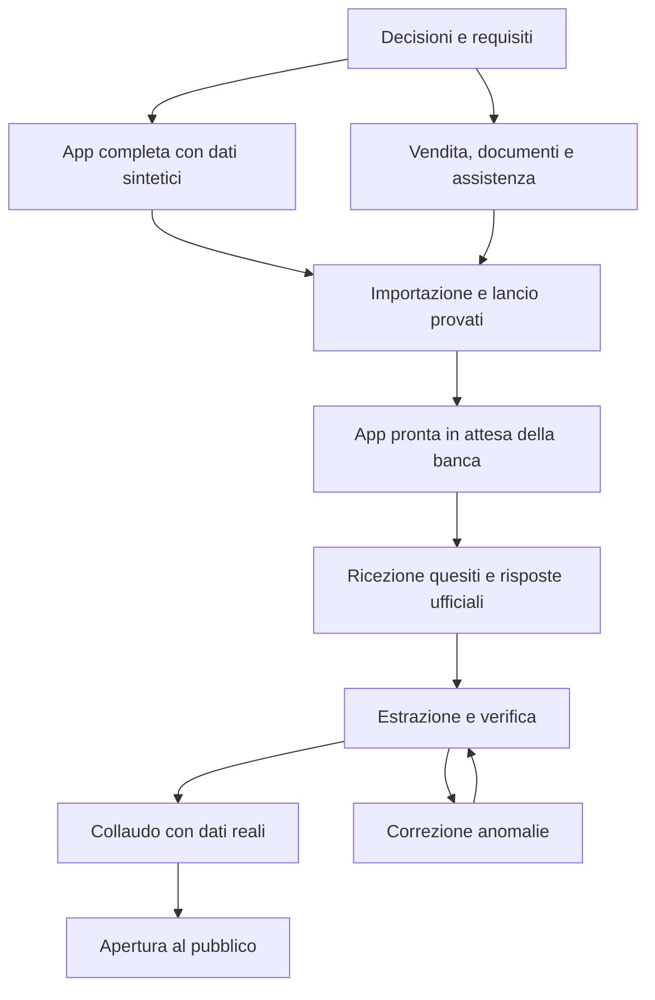

# Piano completo del servizio di preparazione Sanitaservice ASL BA

Versione 1.0 - 14 ottobre 2026. Stato: proposta di progettazione, da consolidare prima dello sviluppo.

## Obiettivo concordato

Realizzare in seguito un servizio pubblico a pagamento unico con prova gratuita, mantenendo costi contenuti. Preparare e collaudare l'applicativo **prima** della pubblicazione della banca dati; quando Davide fornirà i quesiti ufficiali, integrarli con una procedura già provata e pubblicare il servizio nel minor tempo compatibile con la correttezza dei contenuti.

Questo dossier contiene la pianificazione iniziale. Al momento della sua stesura non era stato realizzato alcun applicativo, account esterno, acquisto o pubblicazione. Lo sviluppo è poi iniziato con una prima versione privata locale: l'avanzamento effettivo è registrato in [realizzazione](../realizzazione/01_prima_versione_privata.md). Il documento originario e il PDF rimangono le fonti iniziali; questo dossier propone le correzioni e specifica le parti mancanti. Non è una garanzia di fattibilità entro una data o un preventivo di sviluppo.

## Come leggere e usare il piano

| Documento | Contenuto | Quando serve |
| --- | --- | --- |
| [01 - Analisi del bando](01_analisi_bando.md) | Regole confermate, lacune, correzioni, calendario e fonti | Prima di prendere decisioni |
| [02 - Specifica del prodotto](02_specifica_prodotto.md) | Perimetro, utenti, schermate, permessi e regole complete del servizio | Per progettare e sviluppare le funzioni |
| [03 - Architettura e dati](03_architettura_dati.md) | Stack consigliato, modello dati, interfacce e sicurezza | Prima di impostare il progetto tecnico |
| [04 - Banca dati e lancio rapido](04_banca_dati_lancio.md) | Contratto di importazione, controlli, versioni e procedura al rilascio | Ora per preparare; poi al ricevimento dei quesiti |
| [05 - Gestione e vendita](05_gestione_vendita.md) | Acquisto, assistenza, privacy, documenti, backup e chiusura | Prima di aprire al pubblico e durante il servizio |
| [06 - Roadmap e attività](06_roadmap_backlog.md) | Fasi, dipendenze, responsabilità e attività verificabili | Per organizzare il lavoro quotidiano |
| [07 - Collaudo e checklist](07_collaudo_checklist.md) | Scenari di test, requisiti di qualità e condizioni di apertura | Durante lo sviluppo e prima di ogni rilascio |
| [08 - Decisioni, costi e rischi](08_decisioni_costi_rischi.md) | Scelte da confermare, budget, sostenibilità e imprevisti | Per trasformare la proposta in un piano eseguibile |

Percorso breve: leggere 01, 02 e 08; chiudere le decisioni essenziali; usare 06 per assegnare le attività. I dettagli 03-05 e i controlli 07 sono parte del perimetro, non allegati facoltativi.

## Strategia raccomandata

1. Scegliere una prima versione piccola ma completa: autenticazione, tre simulazioni gratuite, acquisto, esame, studio, ripasso, statistiche essenziali e amministrazione.
2. Costruire e verificare tutto con un dataset sintetico rappresentativo, chiaramente separato dai contenuti ufficiali.
3. Preparare importatore, controlli, approvazione, pubblicazione della banca e ritorno alla versione precedente prima del rilascio ufficiale.
4. Rendere ambiente, dominio, pagamenti, email, assistenza e documenti pronti in anticipo; vendite disabilitate fino al completamento dei controlli sui dati reali.
5. Ricevere la banca dati, adattare il solo estrattore al formato, verificarla, importarla in prova e autorizzare il lancio dopo la checklist.

## Convenzioni

- **Confermato dall'utente:** servizio pubblico a pagamento unico, prova gratuita, attenzione ai costi, app pronta prima della banca dati.
- **Dal bando:** esclusivamente quanto indicato in 01 con riferimento all'articolo e alla pagina del PDF locale.
- **Proposta:** scelta di prodotto o tecnica utilizzata per rendere il piano concreto; può essere modificata prima di sviluppare.
- **Da verificare:** informazione ancora assente o controllo esterno necessario. Non può diventare una promessa commerciale finché non è risolta.
- **P0:** necessario al primo lancio; **P1:** miglioramento successivo; **P2:** eventuale evoluzione. La priorità non indica l'ordine: le dipendenze sono in 06.

Per ogni attività: assegnare una persona, stimare l'impegno, segnare lo stato e allegare una prova del risultato. Ruoli e tempi proposti non implicano che un team esista già. Nessuna attività di implementazione è completata per il solo fatto che sia descritta qui.

## Quando si può iniziare lo sviluppo

Chiudere D01-D06, D08-D09 e D15-D17 di 08 quanto basta per implementare senza ambiguità: nome e titolare, prezzo di lavoro, scadenza, limiti gratuiti, accessi, stack, provider e tempo iniziale di allenamento. Avviare subito le verifiche sui diritti dei quesiti e sugli adempimenti commerciali, che devono concludersi prima della vendita. Le decisioni dipendenti dalla banca dati si chiuderanno dopo la pubblicazione, senza bloccare il resto.

Il passaggio "pronta in attesa della banca" richiede tutte le condizioni G1 di 07. Il passaggio "pubblicabile" richiede anche G2 e G3. La presenza di 1.500 righe nel database, da sola, non soddisfa questi criteri.

## Fonti iniziali

- [Idea originale](../documentazione_progetto_web_app_simulatore_concorso.md), conservata senza modifiche.
- [Bando fornito](../CONC_SANITASERVICE.pdf), 9 pagine.
- Fonti pubbliche e documentazione dei fornitori: link e data di consultazione nei capitoli pertinenti. Calendari e prezzi vanno ricontrollati prima dell'esecuzione.

## Manutenzione della documentazione

Quando una decisione cambia, aggiornare prima 08, poi tutti i capitoli interessati e le attività di 06. Registrare data, motivo e impatto. Una futura rettifica ufficiale aggiorna la configurazione del concorso e le nuove simulazioni; i tentativi storici mantengono le regole e i quesiti usati al momento. Prima di chiedere sviluppo a un agente, indicare questi documenti, il blocco di attività da eseguire e i relativi criteri di 07.
